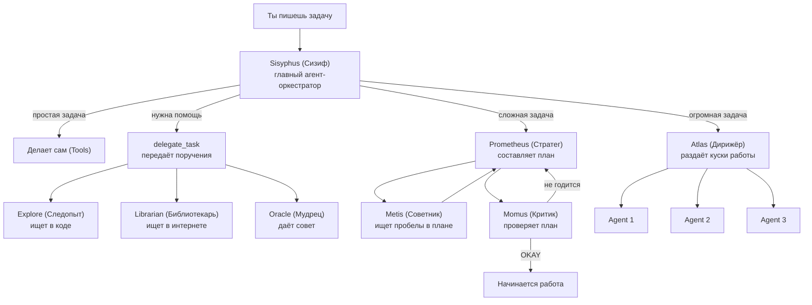

# Обзор: как устроен OMO целиком

> Читается за 5 минут. Это карта всей системы — держи её в уме, пока читаешь остальные главы. В скобках — настоящие термины OMO.

## Если совсем коротко

OMO (**Plugin**, надстройка над OpenCode) — это надстройка над обычным ИИ-помощником по программированию. Она добавляет:

- **больше 8 роботов-специалистов (Agents)** — каждый умеет что-то одно, но очень хорошо;
- **невидимую сеть контролёров (Hooks)**, которые незаметно улучшают каждый шаг;
- **цикл, который сам себя перезапускает (Ralph Loop)**, пока задача не будет полностью закончена.

Самая интересная идея — **конвейер из трёх проверяющих**: Prometheus (придумывает план), Metis (ищет в нём дыры) и Momus (придирчиво проверяет и заворачивает обратно, если что-то не так). Это как если бы твою домашнюю работу сначала писал один человек, потом её перепроверял второй, а третий — самый вредный учитель — не ставил зачёт, пока не исправишь все ошибки.

## Главные решения и зачем они нужны

| Решение | Зачем | Какая за это цена |
|---|---|---|
| Роботы (Agents) не помогают друг другу напрямую, а только через "передачу поручения" (**delegate_task**) | Каждый чётко знает свою роль, никто не путается | Немного медленнее — есть лишний шаг передачи |
| Планировщику (**Prometheus**) **запрещено** писать код (это следят "по-настоящему" через Hook, а не на словах) | Планировщик никогда не начнёт тайком кодить вместо того, чтобы планировать | Нужен отдельный Hook-страж, который это проверяет |
| Критик (**Momus**) проверяет не "хорош ли план", а "понятно ли по нему работать" | Критик не лезет не в своё дело — не переделывает чужие решения | Критик может пропустить плохую идею, если она чётко описана |
| Система (**Ralph Loop**) сама перезапускает работу, пока не увидит сигнал "Готово" (**Completion Promise**) | ИИ часто не успевает закончить за один "присест" — цикл гарантирует результат | Есть потолок — не больше 100 попыток подряд (**max_iterations**) |
| Контролёры (**Hooks**) работают незаметно для роботов | Инструкции для роботов остаются короткими и понятными | Труднее разбираться, если что-то идёт не так |
| Часть роботов работает "в фоне" — параллельно (**Background Agents**) | Не тормозит общий разговор, можно изучать сразу несколько направлений | Нужно управлять очередями и ограничениями |

## Четыре сценария совместной работы

### Сценарий 1 — Простая задача

Ты просишь переименовать переменную. Сизиф (**Sisyphus**, главный агент) делает это сам, без посторонней помощи, и **Ralph Loop** проверяет: "Готово? Да. Всё."

```
Ты → Sisyphus → [делает сам инструментами, Tools] → Ralph Loop проверяет <promise>DONE</promise> → конец
```

### Сценарий 2 — Задача средней сложности

Sisyphus понимает, что один не справится, и зовёт на помощь специалистов (**delegate_task**):

- **Explore (Следопыт)** — ищет нужный код внутри проекта. Бесплатно и быстро.
- **Librarian (Библиотекарь)** — ищет информацию в интернете и документации. Недорого.
- **Oracle (Мудрец)** — думает над сложными архитектурными решениями. Дорого, зовут редко.

Sisyphus может позвать Explore и Librarian *одновременно* (в фоне, **run_in_background=true**), не дожидаясь ответа одного, прежде чем спросить другого.

### Сценарий 3 — Сложная задача: конвейер из трёх проверяющих ⭐

Это самая важная идея всей системы.

1. **Prometheus (Стратег)** беседует с тобой и выясняет, чего ты на самом деле хочешь. Ему **запрещено** писать код (это отслеживает Hook под названием `prometheus-md-only`) — только вопросы и план на бумаге (`.md`-файл).
2. **Metis (Советник)** проверяет план *до* того, как он готов — не упустили ли чего-то важного, нет ли скрытых ловушек.
3. **Momus (Критик)** — самый придирчивый. Он читает план и, если находит нестыковки, отправляет его обратно на доработку. По статистике, план в среднем возвращают на переделку 7 раз, прежде чем он получает "ОК" (**OKAY**).

Только после этого начинается настоящая работа.

### Сценарий 4 — Огромная задача: работа в несколько рук

Для по-настоящему больших задач подключается **Atlas (Дирижёр)** — он через `delegate_task()` раздаёт куски работы сразу нескольким агентам, которые трудятся параллельно, как оркестр под управлением дирижёра.

## Схема: кто с кем общается



## Что дальше

Дальше мы разберём каждую часть этой картины подробно — начиная с самого первого шага: как вся эта команда вообще собирается перед началом работы (**Plugin Bootstrap**).

→ [Глава 1: Как просыпается OMO](./01-plugin-bootstrap-ru.md)
