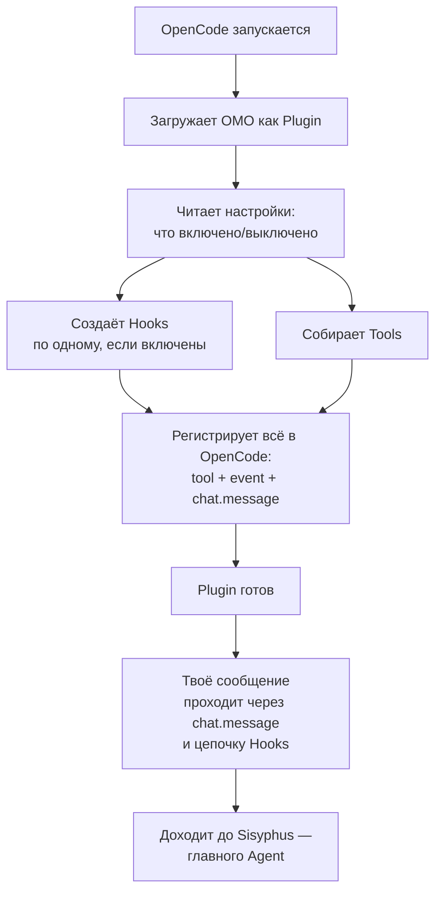

# Глава 1: Как просыпается OMO (Plugin Bootstrap)

> *"Хороший дирижёр решает исход концерта ещё до первой ноты."*

## С чего всё начинается

Ты написал: "Помоги мне переделать вот этот кусок кода". Обычный ИИ-помощник (**OpenCode**) это увидел. Но прежде чем главный робот-начальник (**Sisyphus**) вообще узнает о твоей просьбе, вся команда OMO (сам **Plugin**) должна сначала "проснуться" и подготовиться — это и есть тема этой главы.

## Зачем это нужно

Сам по себе OpenCode — способный, но "пустой" помощник. Он не знает, какую модель мышления включить для сложной задачи, как исправлять свои ошибки, как делить большую работу на части. Работа OMO-плагина — **добавить все эти умения** в самом начале, ещё до того, как начнётся разговор.

## Как это происходит

### Шаг 1. Plugin включается и читает настройки

Когда OpenCode запускается, он зовёт OMO как подключаемый модуль (**Plugin**). Первым делом Plugin читает настройки: какие из его "помощников-контролёров" (**Hooks**) включены, а какие пользователь отключил вручную (**disabled_hooks**).

### Шаг 2. Собираются контролёры (Hooks)

Каждый **Hook** создаётся только если он не выключен в настройках — по принципу переключателя. Например, есть Hook `context-window-monitor`, который следит за переполнением "оперативной памяти" разговора, есть `session-recovery`, который умеет восстанавливать разговор после сбоя, есть `think-mode`, который включает более глубокое размышление для сложных вопросов.

Представь коробку с рычажками: каждый рычажок — это один Hook. Хочешь — включаешь, хочешь — выключаешь.

### Шаг 3. Собирается ящик с инструментами (Tools)

Параллельно готовится набор **Tools**, которыми будут пользоваться роботы (**Agents**): `delegate_task` — передать поручение другому агенту, `call_omo_agent` — вызвать конкретного специалиста напрямую, `skill` — воспользоваться готовым набором знаний.

### Шаг 4. Plugin "подписывает договор" с OpenCode

В конце Plugin сообщает OpenCode: "Вот что я умею". Это как список правил в контракте:

| Что регистрируется | Настоящее название | Зачем |
|---|---|---|
| Инструменты | **tool** | Всё, чем могут пользоваться агенты — поиск, передача заданий, работа с терминалом |
| Реакция на сообщение | **chat.message** | Что происходит, когда приходит твоё сообщение — проверка ключевых слов, запуск циклов |
| Реакция на события | **event** | Обработка системных событий: создание сессии, восстановление после ошибки |
| Проверка перед действием | **tool.execute.before** | Может изменить параметры инструмента или вообще запретить его выполнение |
| Проверка после действия | **tool.execute.after** | Может исправить ошибку или обрезать слишком длинный ответ |

### Шаг 5. Одна дверь — много контролёров (Hooks)

Когда происходит любое событие (**event**), оно проходит через **всех** Hooks по очереди — каждый решает сам, нужно ли ему реагировать. Это как контрольно-пропускной пункт с несколькими постами: событие проходит мимо каждого, и каждый пост либо пропускает его дальше, либо что-то с ним делает.

## Схема запуска

## Главная мысль

**OMO — это не один агент, а целая платформа для агентов.** Работа Plugin — не думать, а *собирать команду*. За доли секунды он подключает больше 30 Hooks, больше 10 Tools и больше 6 Agents — а затем уходит "за кулисы". С этого момента каждое твоё сообщение, каждый вызов инструмента, каждое системное событие проходит через эту заранее сплетённую сеть.

Форму этой сети определяют настройки — `disabled_hooks` может выключить любой Hook, `disabled_agents` может убрать любого Agent. Ничего не "зашито намертво" — всё настраивается.

## Что дальше

Команда собралась. Твоё сообщение "переделай этот код" прошло цепочку Hooks и добралось до Sisyphus. Что он с ним сделает?

→ [Глава 2: Начальник получает задание](./02-sisyphus-planning-ru.md)
