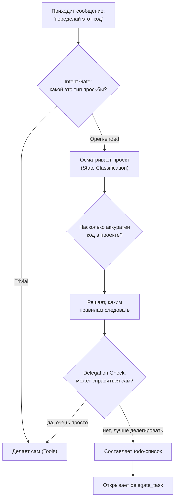

# Глава 2: Начальник получает задание (Sisyphus Planning)

> *"Сизиф каждый день катит камень в гору. Ты каждый день пишешь код. Разница невелика — твой код должен получаться не хуже, чем у опытного инженера."*

## Что было раньше

В [прошлой главе](./01-plugin-bootstrap-ru.md) вся команда OMO собралась и "включилась" (**Plugin Bootstrap**). Твоё сообщение "помоги переделать этот кусок кода" прошло через цепочку Hooks (`chat.message`) и дошло до **Sisyphus** — главного агента-оркестратора (**primary agent**).

Почему его назвали именно так? В древнегреческом мифе Сизиф был обречён вечно катить камень на вершину горы. Идея простая: программирование — это тоже такая работа, которую делаешь снова и снова, и делать её нужно хорошо, как это делал бы опытный инженер, а не абы как.

## Зачем нужна эта глава

Просьба "переделай этот кусок кода" — расплывчатая. Sisyphus не может просто взять и начать что-то менять. Сначала ему нужно **понять, чего от него хотят, осмотреться в проекте и составить план** — это называется Phase 0 → Phase 1.

## Как это происходит

### Шаг 1. Кто такой Sisyphus

Sisyphus описывает себя так: он не "просто рабочий", который делает всё сам, а скорее **опытный инженер-организатор**: разбирает, что скрывается за просьбой, подстраивается под то, насколько аккуратно написан код в проекте, и — самое главное — старается **передавать работу нужным Agents** (`delegating specialized work to the right subagents`), а не тянуть всё на себе.

### Шаг 2. Intent Gate — что это вообще за просьба?

Первое, что делает Sisyphus с *любым* твоим сообщением — определяет его тип. Это называется **Phase 0 — Intent Gate**, и проходит для каждого сообщения без исключений:

| Тип просьбы | Признак | Что делает Sisyphus |
|---|---|---|
| Trivial (простейшая) | Один файл, всё понятно | Делает сразу сам (Direct tools only) |
| Explicit (точная) | Указан конкретный файл/строка | Выполняет напрямую |
| Exploratory (исследовательская) | "Как это работает?" | Запускает Explore параллельно |
| Open-ended (открытая) | "Улучши", "Переделай", "Добавь" | Сначала осматривает проект |
| Ambiguous (неясная) | Непонятно, что нужно | Задаёт один уточняющий вопрос |

"Переделай этот кусок кода" попадает в категорию **Open-ended**. Значит, дальше — осмотреться (**Phase 1**).

### Шаг 3. Осмотр проекта — State Classification

Sisyphus не слепо копирует то, что уже написано в проекте — он сначала оценивает, а стоит ли этому следовать:

| Состояние проекта | Признаки | Поведение |
|---|---|---|
| Disciplined (аккуратный) | Одинаковый стиль, есть тесты | Следовать существующим правилам |
| Transitional (смешанный) | Разные стили в разных местах | Спросить, какому стилю следовать |
| Legacy/Chaotic (запущенный) | Никакой системы нет | Предложить свои правила |
| Greenfield (проект с нуля) | Пустой/новый проект | Использовать современные практики |

### Шаг 4. Delegation Check — обязательная проверка

Прежде чем действовать самому, Sisyphus обязан пройти **Delegation Check**:
1. Есть ли Agent, который идеально подходит для этого?
2. Если нет — есть ли `delegate_task`-категория (**Category**)?
3. Точно ли я могу справиться сам?

Правило по умолчанию (**Default Bias**) простое: **DELEGATE. Работай сам только если это действительно очень просто.**

### Шаг 5. Todo-дисциплина — список дел как счётчик прогресса

Прежде чем начать что-то нетривиальное, Sisyphus обязан составить **todo**-список маленьких шагов через инструмент `todowrite`. Пока делает один шаг (`in_progress`) — остальные ждут (только один одновременно). Закончил — сразу отмечает `completed`. Это позволяет тебе видеть в реальном времени, что именно сейчас происходит.

### Шаг 6. Разные модели — разный способ думать

В зависимости от того, какая ИИ-модель управляет Sisyphus в данный момент (**model**), он думает по-разному: модели вроде Claude используют режим "продумай подробно, прежде чем ответить" (**extended thinking**, `budgetTokens: 32000`), модели вроде GPT используют свой способ рассуждения (**reasoningEffort: "medium"**). Агент один и тот же — способ мышления подстраивается под "мозг".

## Схема пути принятия решения

## Главная мысль

**Первая мысль Sisyphus — не 'как это сделать', а 'кто это должен делать'.** Получив задачу, он проходит по строгой цепочке: Intent Gate → State Classification → Delegation Check → todo-список → и только потом действие. Это не просто совет — это жёсткое правило, записанное в prompt словами вроде `MANDATORY`, `NON-NEGOTIABLE`.

В этом суть философии OMO: **оркестрация важнее исполнения**. Sisyphus мыслит как project manager и берётся за дело своими руками только тогда, когда оно "super simple".

## Что дальше

Sisyphus осмотрел проект и решил: "Эта переделка слишком большая, я не должен делать её один". Он открывает систему `delegate_task`.

→ [Глава 3: Кто кому что поручает](./03-delegation-ru.md)
