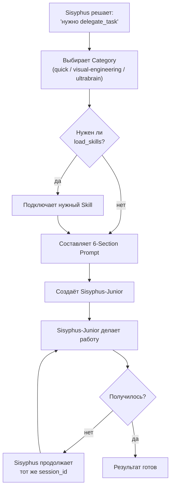

# Глава 3: Кто кому что поручает (Delegation)

> *"Хороший генерал не бросается в атаку сам. Хороший организатор не пишет код сам."*

## Что было раньше

В [прошлой главе](./02-sisyphus-planning-ru.md) Sisyphus осмотрел проект и решил: сам такую большую переделку не потянуть, нужно кому-то поручить. Теперь он пользуется инструментом **delegate_task**.

## Зачем это нужно

Задачу "переделать модуль" нужно разбить на кусочки и раздать разным исполнителям. Но исполнители бывают разные: есть настроенные "режимы работы" под конкретную задачу (**Category**), есть Agents со своей ролью, а есть готовые "шпаргалки" (**Skills**) с профильными знаниями. Как выбрать нужное?

## Как это происходит

### Шаг 1. Настоящий исполнитель — Sisyphus-Junior

Когда Sisyphus вызывает `delegate_task`, на самом деле работать садится не он сам, а **Sisyphus-Junior** — "focused executor". У него та же выучка, что и у Sisyphus, но с важным отличием: ему **заблокированы** инструменты `task` и `delegate_task`. Он может использовать `call_omo_agent`, чтобы позвать Explore или Librarian для исследования, но не может создать ещё одного "младшего себя". Это предотвращает бесконечную цепочку делегирования.

### Шаг 2. Category — готовые "режимы работы"

Прежде чем отправить Sisyphus-Junior работать, можно выбрать заранее настроенную **Category**:

| Category | Насколько "творчески" думает (температура) | Для чего |
|---|---|---|
| `quick` | Низкая | Быстрые, чётко понятные задачи |
| `visual-engineering` | Средняя | Работа с интерфейсом (UI) |
| `ultrabrain` | Низкая, но глубокое размышление | Сложные задачи, требующие тщательного анализа |

### Шаг 3. Skill — шпаргалки со знаниями

Есть готовые Markdown-файлы-инструкции по конкретным темам (например, "как правильно писать компоненты в React"). Когда Sisyphus указывает `load_skills=["react-patterns"]`, содержимое Skill подставляется прямо в начало prompt для Sisyphus-Junior — чтобы он сразу знал правила этой конкретной области.

### Шаг 4. Session ID — память между попытками

Каждый вызов `delegate_task()` возвращает свой **session_id**. Если Sisyphus-Junior не справился с первого раза, Sisyphus может продолжить **тот же session_id**, а не начинать заново — тогда агент помнит всё, что уже пробовал, и не должен заново читать все файлы. Это экономит по некоторым оценкам больше 70% токенов.

### Шаг 5. Поручение из шести пунктов — 6-Section Prompt

Каждое поручение, которое Sisyphus отдаёт через `delegate_task`, должно содержать шесть обязательных частей:

1. **TASK** — что именно нужно сделать, максимально конкретно
2. **EXPECTED OUTCOME** — как понять, что всё готово
3. **REQUIRED TOOLS** — чем можно пользоваться (белый список)
4. **MUST DO** — подробно, без "само собой разумеется"
5. **MUST NOT DO** — что делать запрещено, чтобы не вышли за рамки задачи
6. **CONTEXT** — пути к файлам, уже существующие правила, ограничения

Это не бюрократия ради бюрократии — это **забор**, который не даёт Sisyphus-Junior "уйти не туда".

## Схема передачи задания

## Главная мысль

**delegate_task — не значит 'спихнуть работу'. Это точная наводка.** Правило шести частей (6-Section Prompt) — не формальность, а защита от того, чтобы Sisyphus-Junior "не понял правильно" и не сделал лишнего.

Category выбирает нужную "модель мышления", Skill добавляет профильные знания, а session_id не даёт забыть, что уже пробовали. Вместе это делает каждое поручение точным, осведомлённым и с памятью.

## Что дальше

Sisyphus раздал поручения, но не всё подходит для Sisyphus-Junior — иногда нужен только анализ без изменений (Oracle), поиск по коду (Explore) или поиск во внешней документации (Librarian).

→ [Глава 4: Команда специалистов](./04-specialist-agents-ru.md)
