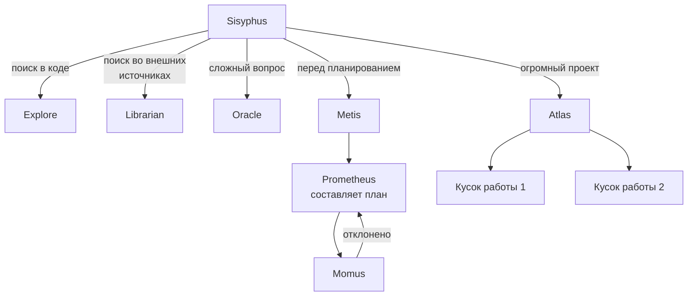

# Глава 4: Команда специалистов (Specialist Agents)

> *"Не каждую проблему нужно решать одним и тем же молотком. Oracle думает, Explore ищет, Librarian читает — у каждого своя работа."*

## Что было раньше

В [прошлой главе](./03-delegation-ru.md) Sisyphus научился передавать поручения через `delegate_task` обычному исполнителю (Sisyphus-Junior). Но не всякую работу можно доверить исполнителю — иногда нужна не переделка кода, а **поиск, анализ или проверка**.

## Зачем это нужно

Во время большой переделки Sisyphus нужно: понять, как связаны между собой части модуля, найти лучшие практики для внешней библиотеки, и после изменений устроить архитектурную проверку. Для этих трёх задач нужны три разных Agents.

## Знакомство с командой

### Explore (Следопыт) — поисковик по коду проекта

Explore работает в режиме **subagent** и **ничего не меняет** — только ищет. Его задача — "contextual grep for codebases": отвечать на вопросы вроде "Where is X?", "Which file has Y?". Он умнее обычного `grep`: использует LSP-инструменты для семантики, `ast_grep_search` для структурных паттернов, обычный `grep` для текста и `glob` для файлов по имени.

**Ключевое ограничение**: Explore заблокированы инструменты `write`, `edit`, `task`, `delegate_task`, `call_omo_agent`. Чистый поиск, без побочных эффектов.

### Librarian (Библиотекарь) — окно во внешний мир

Librarian занимается **внешней информацией**: официальной документацией, репозиториями на GitHub, форумами (multi-repository analysis). У него есть чёткий порядок действий (Phase 0.5 — Documentation Discovery): сначала веб-поиск официального сайта документации, затем проверка версии, затем `webfetch` карты сайта (sitemap), а потом уже целенаправленное исследование. Каждый вывод Librarian обязательно должен подкрепляться **GitHub permalink** как доказательством.

### Oracle (Мудрец) — дорогой, но умный советчик

Oracle — "read-only consultation agent, high-IQ reasoning specialist". Самый "дорогой" Agent (extended thinking + топовая модель). Ему через `createAgentToolRestrictions` **заблокированы** `write`, `edit`, `task`, `delegate_task` — только анализировать и советовать. Его зовут: после 2+ неудачных попыток исправить ошибку, для сложных архитектурных решений, для проблем безопасности/производительности.

### Metis (Советник) — задаёт вопросы до планирования

Metis (Pre-Planning Consultant) — назван в честь греческой богини мудрости. Вступает в игру ещё **до того**, как появится план. Сначала определяет тип задачи (переделка? создание с нуля? исследование?), затем задаёт уточняющие вопросы и ищет так называемые **AI-Slop Patterns** — типичные ловушки ИИ (раздутый scope, преждевременная абстракция, избыточная валидация).

### Momus (Критик) — проверяющий планов

Momus назван в честь греческого бога насмешки и придирок. Проверяет рабочие планы предельно строго — "Historical Data: Plans from this author average 7 rejections before receiving an OKAY". Он "проигрывает в уме" (`simulate actually doing the work`) каждый шаг плана, проверяет каждую ссылку на файл и следит, чтобы плана хватило для реальной работы без домысливания.

### Atlas (Дирижёр) — командует большими проектами

Atlas — "Master Orchestrator Agent". Это "режим больших проектов" (primary agent) для Sisyphus. Когда есть длинный todo-список, Atlas берёт управление на себя и через `delegate_task()` распределяет задачи, проверяя каждый результат, пока весь список не будет выполнен.

## Кто что может — таблица прав (Agent Permission Matrix)

| Agent | write/edit | task | delegate_task | call_omo_agent | Mode |
|---|---|---|---|---|---|
| Sisyphus | ✅ | ✅ | ✅ | ❌ | primary |
| Sisyphus-Junior | ✅ | ❌ | ❌ | ✅ | subagent |
| Oracle | ❌ | ❌ | ❌ | — | subagent |
| Explore | ❌ | ❌ | ❌ | ❌ | subagent |
| Librarian | ❌ | ❌ | ❌ | ❌ | subagent |
| Metis | ❌ | ❌ | ❌ | ✅ | subagent |
| Momus | ❌ | ❌ | ❌ | — | subagent |
| Atlas | ❌ | ❌ | ✅ | ❌ | primary |

## Схема команды

## Главная мысль

**Права Agent — это и есть его характер.** Oracle нельзя писать код, поэтому его совет всегда остаётся *просто советом* — он никогда случайно не изменит файл. Explore нельзя делегировать — он не начнёт "самовольничать". Sisyphus-Junior нельзя снова использовать `delegate_task` — это не даёт цепочке передачи заданий уйти в бесконечность.

Это не вопрос доверия — это **структурная безопасность**. Ограничения каждого Agent формируют его поведение.

## Что дальше

Пока специалисты работают, каждый их шаг незаметно проходит через сеть Hooks — они могут "на лету" усилить размышление или подсказать правила проекта.

→ [Глава 5: Невидимые контролёры](./05-hook-pipeline-ru.md)
