# Глава 5: Невидимые контролёры (Hook Pipeline)

> *"Лучшая инфраструктура — та, которую не замечаешь, пока она тебя не спасла."*

## Что было раньше

В [прошлой главе](./04-specialist-agents-ru.md) мы познакомились с командой специалистов (Agents). Но пока они работают, каждый вызов инструмента, каждое сообщение и каждое системное событие проходит через **невидимую цепочку Hooks**.

## Зачем это нужно

Во время работы с агентами случается разное: пользователь хочет более глубокого размышления, в проекте есть свои правила оформления кода, память разговора вот-вот переполнится, инструмент редактирования выдал ошибку. Всё это не должно решаться самим Agent вручную — это должно **перехватываться и исправляться прозрачно (transparently)**, за кулисами.

## Четыре точки входа Hook

Hooks цепляются к четырём ключевым моментам:
- `chat.message` — когда приходит сообщение;
- `event` — когда происходит системное событие;
- `tool.execute.before` — прямо перед выполнением инструмента;
- `tool.execute.after` — сразу после выполнения инструмента.

### Think Mode — режим "подумать подольше" по ключевому слову

Hook `think-mode` смотрит текст твоего сообщения. Если находит ключевое слово вроде "think" — автоматически переключает модель на более "вдумчивый" вариант (**highVariant**) и добавляет конфиг extended thinking. Ты об этом даже не узнаешь — просто ответ станет более продуманным.

### Rules Injector — внедрение правил проекта

Hook `rules-injector` следит за тем, когда Agent читает, создаёт или редактирует файл (`TRACKED_TOOLS = ["read", "write", "edit", "multiedit"]`). Он ищет в проекте файлы правил (что-то вроде `.cursorrules`), проверяет их frontmatter (подходят ли они к текущей ситуации) и **вставляет содержимое прямо в вывод инструмента**. Agent не знает, что такие правила вообще существуют — он просто увидит их в следующий раз, когда будет размышлять.

### Context Window Monitor — страж памяти разговора

Hook `context-window-monitor` следит за тем, сколько токенов уже израсходовано после каждого `tool.execute.after`. Когда становится тесно — предупреждает или автоматически сжимает историю (compact).

### Tool Output Truncator — обрезание слишком длинных ответов

Если инструмент вернул огромный кусок текста, `tool-output-truncator` автоматически его обрезает — чтобы один такой ответ не занял всю доступную context window.

### Directory Agents Injector — настройки проекта

Hook `directory-agents-injector` обнаруживает конфигурацию `.agents` в папке проекта и автоматически подключает её к работе agents конкретно в этом проекте.

### Двойной контроль на каждый вызов инструмента

Каждый вызов Tool проходит **два поста проверки**: `tool.execute.before` (можно изменить параметры, добавить правила) и `tool.execute.after` (можно обрезать вывод, исправить ошибку). Все Hooks в очереди вызываются один за другим, например:

```
tool.execute.before → rules-injector, comment-checker, ...
tool.execute.after → tool-output-truncator, context-window-monitor, edit-error-recovery, ...
```

### Всё можно включить и выключить

Каждый Hook можно отключить через `disabled_hooks: ["think-mode"]` в настройках. Не нравится Think Mode — просто выключи именно его, остальные продолжат работать.

## Схема Hook Pipeline

```mermaid
flowchart LR
    MSG["chat.message\nсообщение приходит"] --> H1["Hook: think-mode"]
    H1 --> AGENT["Agent работает"]
    AGENT --> B1["tool.execute.before"]
    B1 --> B2["Hook: rules-injector"]
    B2 --> TOOL["Tool выполняется"]
    TOOL --> A1["tool.execute.after"]
    A1 --> A2["Hook: tool-output-truncator"]
    A2 --> A3["Hook: context-window-monitor"]
    A3 --> A4["Hook: edit-error-recovery"]
    A4 --> RESULT["Agent видит\nулучшенный результат"]
```



## Главная мысль

**Hooks — это промежуточный слой OMO (middleware).** Как и в веб-серверах (например, Express.js), каждое событие проходит через цепочку обработчиков. Но у OMO это устроено более тонко — есть четыре разных lifecycle-точки, и на каждую точку — своя цепочка Hooks.

Плюс такого устройства — **разделение ответственности (separation of concerns)**: Think Mode не знает о Rules Injector, тот — о Context Window Monitor. Каждый занимается своим делом, а взаимодействуют они, изменяя input/output.

## Что дальше

В цепочке Hooks есть особенно важный — `edit-error-recovery`, который автоматически чинит ошибки редактирования. Вместе с `session-recovery` и защитой от переполнения контекста OMO строит целую систему устойчивости к ошибкам.

→ [Глава 6: Когда что-то ломается](./06-error-recovery-ru.md)
