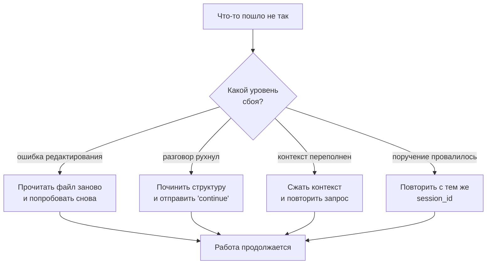

# Глава 6: Когда что-то ломается (Error Recovery)

> *"ИИ не может не ошибаться. Но хороший ИИ умеет исправляться."*

## Что было раньше

В [прошлой главе](./05-hook-pipeline-ru.md) мы увидели, как Hooks незаметно улучшают каждый шаг. Теперь представим: во время переделки кода один из агентов **ошибся при редактировании** — попытался заменить кусок текста, которого в файле уже нет.

## Зачем это нужно

Агенты ошибаются часто: думают, что в файле написано одно, а там на самом деле другое; context window переполняется; иногда весь разговор вообще "падает" (session error). Если каждую такую мелочь придётся исправлять вручную, вся польза от команды роботов теряется.

## Три (плюс один) уровня спасения

### Уровень 1. Edit Error Recovery — автоматическое исправление правки

Есть Hook `edit-error-recovery` с тремя классическими паттернами ошибок (`EDIT_ERROR_PATTERNS`): "oldString and newString must be different", "oldString not found", "oldString found multiple times". Когда `tool.execute.after` видит такую ошибку, он не пытается просто повторить попытку — он **добавляет к output строгую инструкцию** (`EDIT_ERROR_REMINDER`):

1. READ the file immediately — прочитать файл заново
2. VERIFY — убедиться, как на самом деле выглядит текст
3. CONTINUE — действовать заново, опираясь на реальное содержимое

Это не "повторить попытку наугад" — это заставить агента **сначала посмотреть правде в глаза**, а потом уже действовать.

### Уровень 2. Session Recovery — восстановление разговора

Иногда весь разговор технически "ломается" — например, из-за ошибки API (`session.error`). Hook `session-recovery` умеет распознавать поправимые сбои (`isRecoverableError`) — вроде `tool_result_missing` или `thinking_block_order` — чинит внутреннюю структуру сообщений и **сам** отправляет команду `"continue"` через `ctx.client.session.prompt`. Пользователь может даже не заметить, что что-то сломалось.

### Уровень 3. Context Window Limit Recovery — восстановление после переполнения

Когда Anthropic API отвечает ошибкой token limit, Hook `anthropic-context-window-limit-recovery` распознаёт её (`parseAnthropicTokenLimitError`), автоматически **сжимает** контекст (`executeCompact`) и заново отправляет запрос. Не нужно вручную создавать новую сессию.

### Дополнительный уровень: Delegate Task Retry

Hook `delegate-task-retry` — если переданное через `delegate_task` поручение провалилось, он автоматически повторяет попытку, используя тот же самый `session_id`, чтобы не терять уже собранный контекст.

## Четыре уровня — сводная таблица

| Уровень | Hook | Восстанавливает |
|---|---|---|
| Уровень инструмента | Edit Error Recovery | Одна неудачная правка файла |
| Уровень сессии | Session Recovery | Крах разговора / ошибка API |
| Уровень контекста | Context Window Limit Recovery | Token превышен |
| Уровень задачи | Delegate Task Retry | Провал переданного задания |

## Схема восстановления

## Главная мысль

**Восстановление в OMO — это не 'попробовать ещё раз', а 'понять ошибку и исправить причину'.** Edit Error Recovery — не тупое повторение действия, а заставить агента сначала перечитать файл. Session Recovery — не перезапуск с нуля, а починка структуры и продолжение. Context Window Recovery — не отказ от задачи, а сжатие и повтор.

Каждый уровень восстановления **понимает смысл** ошибки и подбирает подходящее лекарство именно для неё.

## Что дальше

А что, если задача слишком большая и один поток работы — слишком медленно? OMO умеет запускать несколько агентов параллельно (Background Agents).

→ [Глава 7: Работа в несколько рук](./07-background-agents-ru.md)
