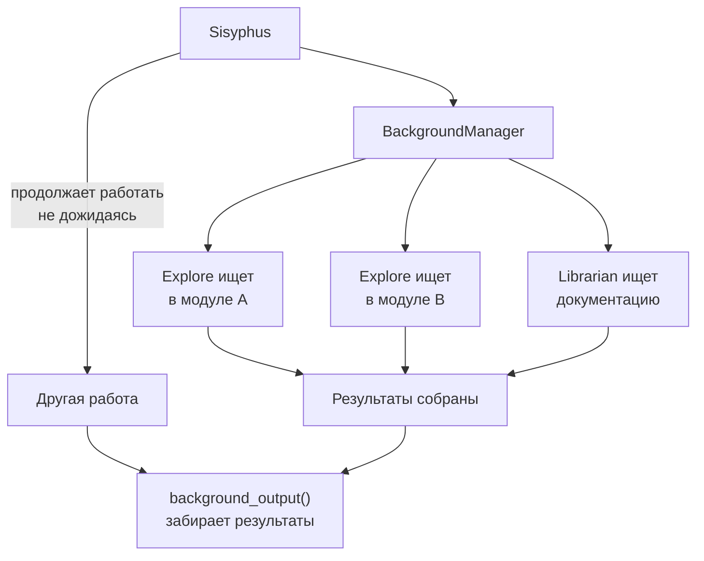

# Глава 7: Работа в несколько рук (Background Agents)

> *"Один агент — это один поток. Несколько агентов — это уже настоящая работа в команде."*

## Что было раньше

В [прошлой главе](./06-error-recovery-ru.md) мы увидели, как OMO сам справляется с ошибками. Теперь Sisyphus понимает: переделка слишком большая — нужно искать код сразу в нескольких модулях и выполнять несколько независимых подзадач одновременно.

## Зачем это нужно

Обычно вся система работает "в один поток" — в один момент времени только один Agent что-то делает. Но многие вещи можно делать параллельно: искать код сразу в нескольких направлениях, менять несколько независимых файлов одновременно.

## Как это устроено

### BackgroundManager — диспетчер фоновых задач

`BackgroundManager` умеет через `launch()` создавать отдельные фоновые OpenCode-сессии — каждая со своим Agent внутри. Они пользуются общей файловой системой (видят один и тот же код), но у каждой — **своя отдельная context window**, они не мешают друг другу.

### ConcurrencyManager — контроль количества одновременных задач

`ConcurrencyManager` следит, чтобы одновременно не запускалось слишком много агентов — если лимит превышен, лишние задачи становятся в очередь и ждут.

### Background Tools — инструменты для работы с фоном

Регистрируются инструменты `background_output(task_id)` — забрать результат фоновой задачи, и `background_cancel(task_id/all)` — отменить фоновую задачу.

### Главное правило: Explore и Librarian — всегда в фоне

В prompt Sisyphus прямо написано: "Explore/Librarian = Grep, not consultants. CORRECT: Always background, always parallel". Он вызывает `delegate_task(subagent_type="explore", run_in_background=true, ...)` сразу для нескольких запросов и **продолжает работать немедленно**, а результаты забирает через `background_output`, когда они понадобятся.

### TmuxSessionManager — визуализация в терминале

Есть необязательная возможность (по умолчанию `enabled: false`) — показывать, что делает каждый фоновый агент, прямо в отдельных окнах tmux, чтобы можно было "подглядывать" за прогрессом.

### Жизненный цикл фоновой задачи

- `TASK_TTL_MS` — максимум около 30 минут на задачу
- `MIN_STABILITY_TIME_MS` — минимум 10 секунд "на разгон"
- `DEFAULT_STALE_TIMEOUT_MS` — 3 минуты без ответа = задача считается зависшей (stale)

### Background Notification

Hook `background-notification` — когда фоновая задача завершается (успешно или с ошибкой), приходит уведомление в основную сессию, и Sisyphus сам решает, нужно ли забирать результат прямо сейчас.

## Схема параллельной работы

## Главная мысль

**Background Agent — это не 'ещё одна вкладка', а настоящая структурированная параллельность.** BackgroundManager следит за количеством одновременных задач (concurrency), управляет жизненным циклом задачи, обрабатывает stale-детект. Каждый фоновый агент работает независимо, не мешая остальным.

Sisyphus работает так: запускает сразу 3-5 `explore`/`librarian` задач в фон, сам продолжает заниматься другими делами, а когда нужны результаты — забирает их через `background_output`. Это не "подождать асинхронно" — это **настоящий параллельный рабочий процесс**.

## Что дальше

Prompt-инструкции этих агентов не написаны раз и навсегда — они собираются "на лету" из того, какие agents, tools и skills доступны прямо сейчас.

→ [Глава 8: Инструкции на лету](./08-dynamic-prompts-ru.md)
