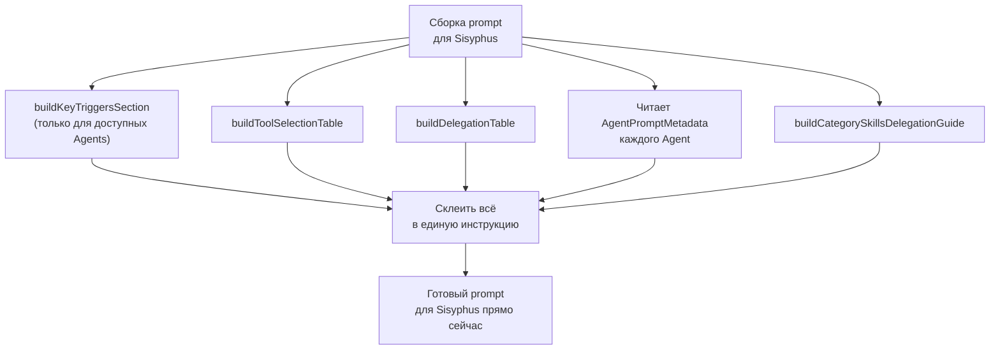

# Глава 8: Инструкции на лету (Dynamic Prompts)

> *"Инструкция, зашитая намертво, — это долг. Инструкция, собранная на лету, — это актив."*

## Что было раньше

В [прошлой главе](./07-background-agents-ru.md) мы увидели, как Background Agents работают параллельно. А теперь — откуда вообще берутся prompt-инструкции для каждого агента?

## Зачем это нужно

Команда OMO настраиваемая — можно отключить одного из специалистов, добавить свою Category, подключить новый Skill. Если бы prompt Sisyphus был написан один раз и навсегда, например "у тебя есть Oracle, Explore, Librarian", то при отключённом Librarian Sisyphus всё равно попытался бы позвать несуществующего агента.

## Как это устроено

### Динамический сборщик — dynamic-agent-prompt-builder

Prompt Sisyphus собирается из результатов работы **больше десятка отдельных функций**: `buildKeyTriggersSection`, `buildToolSelectionTable`, `buildExploreSection`, `buildLibrarianSection`, `buildDelegationTable`, `buildCategorySkillsDelegationGuide`, `buildOracleSection`, `buildHardBlocksSection`, `buildAntiPatternsSection`, `categorizeTools` — каждая отвечает за свой раздел.

### buildKeyTriggersSection — "триггеры": когда кого звать

Эта функция собирает список **Key Triggers** — подсказок вида "если видишь упоминание внешней библиотеки → зови Librarian". В финальный prompt попадают **только те triggers**, чьи агенты реально доступны прямо сейчас (`agents.filter(a => a.metadata.keyTrigger)`). Если Librarian отключили — его подсказка просто не появится.

### buildToolSelectionTable — таблица "чем пользоваться"

Функция строит таблицу `Resource | Cost | When to Use`: какие Tools и Agents доступны, сколько стоит их использование (`FREE`, `CHEAP`, `EXPENSIVE`), когда их применять. Эта таблица **собирается заново каждый раз** — реально актуальный список того, что есть под рукой прямо сейчас.

### buildDelegationTable — таблица "кому что передать"

Отдельная функция строит **Delegation Table**: для какой области (`domain`) какой Agent подходит и по какому `trigger` его нужно звать.

### Agent Prompt Metadata — каждый специалист сам о себе рассказывает

У каждого Agent есть собственное `AgentPromptMetadata` — например, `ORACLE_PROMPT_METADATA` содержит `category: "advisor"`, `cost: "EXPENSIVE"`, `triggers`, `useWhen`, `avoidWhen`. Sisyphus не хранит эту информацию сам — он **читает её из метаданных** каждого Agent и вставляет в свой prompt.

### buildCategorySkillsDelegationGuide — подключение Skills и Categories

Ещё одна функция перечисляет все доступные Skills и все настроенные Categories, формируя правило "MANDATORY: Evaluate ALL skills for relevance".

### Финальная сборка

В `buildDynamicSisyphusPrompt` все части соединяются в один большой `<Behavior_Instructions>` — Role Sisyphus, keyTriggers, toolSelection, exploreSection и так далее.

## Схема сборки инструкции

## Главная мысль

**Каждый Agent участвует в написании prompt Sisyphus.** Когда у Oracle в `ORACLE_PROMPT_METADATA` прописаны `triggers` и `useWhen` — он тем самым сам сообщает Sisyphus: "в такой ситуации зови меня". Это не Sisyphus так решил заранее — это каждый Agent **сам заявил о себе** (self-descriptive metadata), а builder автоматически всё расставил по местам.

Это значит: чтобы добавить нового Agent, не нужно переписывать код Sisyphus — достаточно описать `AgentPromptMetadata`, и он сам появится в tool matrix и delegation table.

## Что дальше

Dynamic prompt рассказывает агенту, какие Tools доступны. Но инструменты OMO — это не только стандартный набор, встроенный в OpenCode, а гораздо более мощные средства: AST-поиск, LSP-интеграция и постоянная терминальная сессия.

→ [Глава 9: Крутые инструменты](./09-crafted-tools-ru.md)
