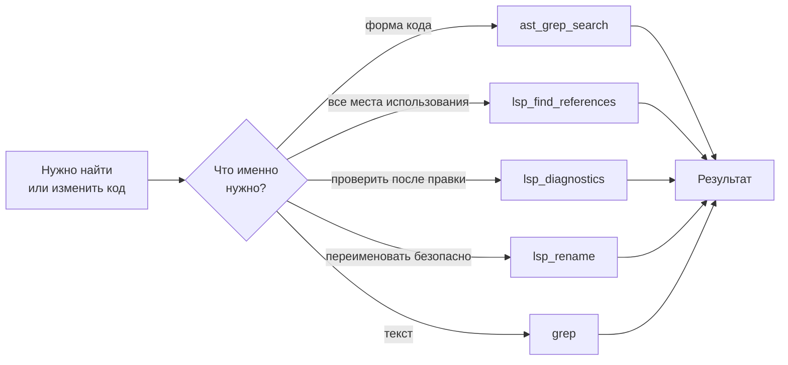

# Глава 9: Крутые инструменты (Crafted Tools)

> *"Обычный поиск текста находит буквы. Поиск по структуре находит форму. Понимание смысла кода находит связи. Вместе коду негде спрятаться."*

## Что было раньше

В [прошлой главе](./08-dynamic-prompts-ru.md) мы увидели, как собирается prompt для Sisyphus — он рассказывает, какие Tools доступны. Теперь посмотрим, насколько эти Tools мощные.

## Зачем это нужно

Обычных `grep` и `read`, встроенных в OpenCode, достаточно для простых поисков. Но для настоящей переделки кода нужно: **структурно-осознанный поиск** ("найди все `export async function` с двумя параметрами"), **семантическое понимание** ("где именно используется эта функция?") и постоянная терминальная сессия.

## Инструменты команды

### ast_grep_search — AST-осознанный поиск кода

`ast_grep_search` под капотом вызывает CLI-утилиту [ast-grep](https://ast-grep.github.io/). Он понимает не текст, а **структуру кода (AST)** — поддерживает 25 языков программирования и мета-переменные: `$VAR` (один узел), `$$$` (несколько узлов). Например:

```
pattern: "export async function $NAME($$$) { $$$ }"   // все async-функции
pattern: "console.log($MSG)"                            // все вызовы console.log
```

Есть парный инструмент `ast_grep_replace` (с `dryRun=true` для предпросмотра) для структурной замены кода.

Умный бонус: если поиск ничего не нашёл (`getEmptyResultHint`), инструмент проверяет типичные ошибки в шаблоне и подсказывает, как его поправить — например, для Python убрать лишнее двоеточие в конце.

### LSP Tools — набор инструментов уровня IDE

Есть целый набор инструментов, подключённых к настоящему Language Server:

- `lsp_goto_definition` — перейти к определению
- `lsp_find_references` — найти все места использования
- `lsp_symbols` — список символов файла/проекта
- `lsp_diagnostics` — ошибки и предупреждения
- `lsp_prepare_rename` / `lsp_rename` — проверка и безопасное переименование

Разница с `grep` огромная: `lsp_find_references` находит **все настоящие семантические связи** — включая типы, импорты и повторный экспорт, а не просто текстовые совпадения.

`lsp_diagnostics` — это команда-валидатор Sisyphus: после каждого изменения он обязан её запускать, чтобы убедиться в отсутствии ошибок типов.

### interactive_bash — постоянная терминальная сессия

`interactive_bash` — это не обычный `exec`, а **постоянная (persistent) bash-сессия**: переменные окружения, рабочая директория, фоновые процессы сохраняются между вызовами. Отдельный Hook `interactive-bash-session` следит за жизненным циклом такой сессии.

### categorizeTools — классификация инструментов

Функция `categorizeTools` автоматически распределяет инструменты по категориям по префиксу имени: `lsp_*` → категория "lsp", `ast_grep*` → "ast", `grep`/`glob` → "search", `session_*` → "session".

### Сравнение инструментов

| Tool | Как ищет | Когда лучше всего подходит |
|---|---|---|
| `grep` | Текстовое совпадение | Строки, комментарии, логи |
| `glob` | Совпадение имени файла | Найти файл по названию/расширению |
| `ast_grep_search` | AST-структура | Сигнатуры функций, шаблоны кода |
| `lsp_find_references` | Семантические связи | Анализ влияния перед рефакторингом |
| `lsp_diagnostics` | Проверка типов | Проверить код после правки |
| `lsp_rename` | Семантическая замена | Безопасное переименование символа |

## Схема набора инструментов



## Главная мысль

**Инструменты OMO — это не 'улучшенные команды shell', а API-доступ к возможностям целой IDE.** LSP tools дают агенту семантическое понимание уровня VS Code: goto definition, find references, safe rename, real-time diagnostics. ast-grep добавляет структурный поиск.

Вместе это позволяет агенту при рефакторинге: сначала `lsp_find_references`, чтобы понять зону влияния, затем `ast_grep_search`, чтобы найти все совпадения по шаблону, а после правки — `lsp_diagnostics` для проверки. Именно поэтому в prompt Sisyphus написано: "your code should be indistinguishable from a senior engineer's" — потому что у него в руках инструментарий senior-инженера.

## Что дальше

Многие пользователи переходят к OMO из другого похожего инструмента — Claude Code. Как OMO делает этот переход бесшовным?

→ [Глава 10: Дружба со старыми привычками](./10-cc-compatibility-ru.md)
