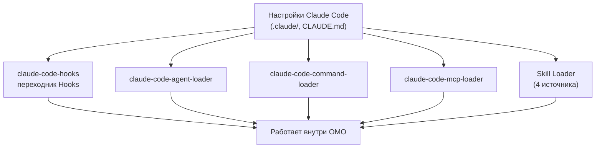

# Глава 10: Дружба со старыми привычками (CC Compatibility)

> *"Не заставляй пользователя менять привычки под инструмент — пусть инструмент подстраивается под привычки пользователя."*

## Что было раньше

В [прошлой главе](./09-crafted-tools-ru.md) мы увидели набор продвинутых Tools OMO. Но многие пользователи приходят из другого похожего продукта — **Claude Code**, и у них уже есть своя папка `.claude`, файл `CLAUDE.md`, свои Hooks и подключённые MCP-серверы.

## Зачем это нужно

Когда человек переходит с Claude Code на OpenCode + OMO, он не должен настраивать всё заново. Всё, что уже есть — `CLAUDE.md`, `.claude/settings.json`, кастомные hooks, MCP servers — должно **заработать сразу же**, без переделки.

## Как это устроено

### Claude Code Hooks — переходник для чужих контролёров

Модуль `claude-code-hooks` — это "hook для hooks": он загружает конфигурацию hooks в формате Claude Code и адаптирует её к интерфейсу OpenCode. Поддерживаются: `pre-tool-use`, `post-tool-use`, `stop`, `user-prompt-submit`, `todo`, `transcript`.

### Claude Code Agent Loader — загрузчик специалистов из старого формата

Модуль `claude-code-agent-loader` находит кастомных агентов, определённых в папке `.claude/`, и превращает их в формат `AgentConfig`, понятный OpenCode.

### Claude Code Command Loader — загрузчик команд

Похожим образом `claude-code-command-loader` загружает пользовательские slash-команды из формата Claude Code и регистрирует их как обычные команды OpenCode.

### Claude Code MCP Loader — загрузчик подключённых сервисов

Модуль `claude-code-mcp-loader` читает конфигурацию MCP-серверов из `.claude/settings.json` и превращает их в формат MCP, понятный OpenCode (включая `env-expander` для переменных окружения).

### Claude Code Session State — память о сессиях

Модуль `claude-code-session-state` следит за тем, какая сессия главная (`setMainSession`), какие — дочерние, и какой agent за какую сессию отвечает (`setSessionAgent`).

### Skill Loader — загрузчик шпаргалок из четырёх мест

Skills подгружаются сразу из четырёх источников и объединяются функцией `mergeSkills`:

- `discoverUserClaudeSkills` — личная папка `~/.claude/`
- `discoverProjectClaudeSkills` — папка проекта `.claude/`
- `discoverOpencodeGlobalSkills` — глобальные skills OpenCode
- `discoverOpencodeProjectSkills` — skills проекта в формате OpenCode

### Переключатель совместимости

Настройка `pluginConfig.claude_code?.skills !== false` позволяет пользователю отключить весь слой совместимости с Claude Code одной строкой конфигурации.

## Схема совместимости

## Главная мысль

**Совместимость с Claude Code — это не компромисс, а уважение к чужому времени.** Пользователи Claude Code могли потратить недели на настройку hooks, написание `CLAUDE.md`, подключение MCP servers. Слой совместимости в OMO гарантирует, что этот труд не пропадёт впустую — всё переезжает и сразу работает.

Заодно это делает OMO расширяемым: теперь Hook Pipeline понимает и родной формат OMO, и формат Claude Code одновременно. Можно мигрировать постепенно — а можно вообще никогда не мигрировать полностью.

## Что дальше

Все механизмы на месте: команда Agents, Hook Pipeline, Error Recovery, Background Agents. Остался последний вопрос — как заставить задачу **выполняться автоматически до самого конца**, без постоянного вмешательства человека?

→ [Глава 11: Цикл до победного](./11-ralph-loop-ru.md)
