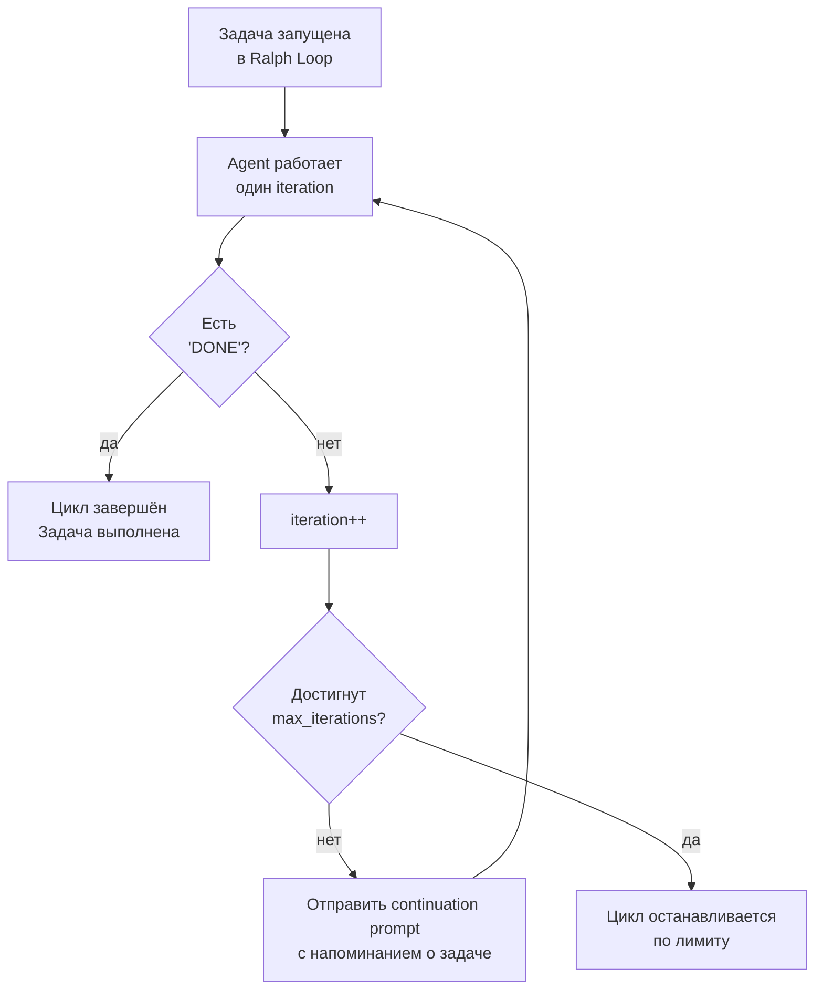

# Глава 11: Цикл до победного (Ralph Loop)

> *"Ральфу не нужно, чтобы за ним следили. Дай ему задачу — он будет крутить цикл, пока не закончит. Или честно скажет, что не может."*

## Что было раньше

В [прошлой главе](./10-cc-compatibility-ru.md) мы увидели, как OMO дружит со старыми привычками пользователей Claude Code. Все части собраны. Теперь — самая важная деталь, которая связывает всё воедино.

## Зачем это нужно

У ИИ-агентов есть общая проблема: они часто останавливаются на полпути. Модель "выговорилась" и замолчала, а задача ещё не закончена. Пользователю приходится вручную писать "продолжай". А если задача требует 20 таких кругов подряд? Именно для этого существует **Ralph Loop** — он **сам** крутит работу, пока задача по-настоящему не будет завершена.

## Как это работает

### Запуск Ralph Loop

Есть метод `startLoop(sessionID, prompt, options)` с параметрами `maxIterations`, `completionPromise`, `ultrawork`. Цикл можно запустить командой `/ralph-loop "закончи этот рефакторинг"` или он включается автоматически, когда система замечает шаблон сообщения с тегом `<user-task>` внутри.

### RalphLoopState — что цикл помнит о себе

Пока цикл активен, он хранит состояние `RalphLoopState`:

```
active            — включён ли цикл сейчас
iteration         — текущий круг
max_iterations    — максимум кругов (по умолчанию 100)
completion_promise — слово-сигнал завершения (по умолчанию "DONE")
started_at        — когда начался
prompt            — исходная задача
ultrawork         — включён ли усиленный режим работы
```

### Как проходит один круг

После каждого ответа агента цикл проверяет: содержит ли вывод `<promise>DONE</promise>`? Если да — цикл останавливается, задача выполнена. Если нет — `iteration++`, и агенту автоматически отправляется **continuation prompt**.

### Continuation Prompt — сообщение "продолжай"

Вместе с командой продолжить, агент получает системную директиву с номером текущего круга и максимумом, напоминанием оглянуться на прогресс, продолжить именно с того места, где остановился, и чёткое указание — выдать `<promise>{{PROMISE}}</promise>`, только когда всё **по-настоящему** закончено. Так агент каждый раз видит, на каком он круге и что было исходной задачей (`{{PROMPT}}`) — это сохраняет **связность** работы между кругами.

### Completion Promise — сигнал завершения

```
COMPLETION_TAG_PATTERN = /<promise>(.*?)<\/promise>/is
DEFAULT_COMPLETION_PROMISE = "DONE"
DEFAULT_MAX_ITERATIONS = 100
```

Агент сообщает о завершении конкретной, легко распознаваемой меткой `<promise>DONE</promise>`, а не размытой фразой "кажется, готово". Это чёткий, структурированный сигнал.

### Хранение состояния

Состояние Ralph Loop сохраняется на диск в файл `.sisyphus/ralph-loop.local.md` через `readState()` / `writeState()` / `clearState()` / `incrementIteration()` — так что, даже если процесс перезапустится, цикл можно возобновить с того же места.

### ULW Loop — усиленный режим работы

Команда `ulw-loop` запускает `startLoop` с `ultrawork: true` — более "напористый" режим работы.

### Меры безопасности

| Механизм | Зачем |
|---|---|
| `max_iterations` | Не даёт циклу крутиться бесконечно (по умолчанию 100) |
| `completion_promise` | Чёткая метка, не полагается на догадки |
| `/cancel-ralph` | Пользователь может остановить цикл в любой момент |
| Сохранение состояния | Можно продолжить после перезапуска |

## Схема работы Ralph Loop



## Главная мысль

**Ralph Loop — это клей, который скрепляет все возможности OMO.** На каждом его круге: Hook Pipeline перехватывает каждый вызов инструмента (think-mode, rules-injection, error recovery), Error Recovery автоматически чинит сбои редактирования и падения сессии, Context Window Recovery сжимает контекст при переполнении, Background Agents могут параллельно искать и работать, а Dynamic Prompts каждый раз собирают актуальный набор инструментов.

Ralph Loop — не отдельная функция сама по себе. Это **двигатель**, который заставляет все механизмы из предыдущих десяти глав работать **непрерывно**. Дай ему задачу — и он использует все эти механизмы, круг за кругом, пока агент не выдаст ту самую метку `<promise>DONE</promise>`.

Это и есть главное обещание OMO: **дай мне задачу — я буду работать, пока она не будет сделана.**

## Конец истории

Ты написал: "Помоги мне переделать этот кусок кода". Plugin запустился, Sisyphus разобрал задачу и передал её специалистам через `delegate_task`, Hook Pipeline усилил каждый шаг, Error Recovery справилось с неожиданностями, Background Agents работали параллельно, а Ralph Loop не останавливался — пока переделка не была закончена.

От первой строчки `index.ts` до последней метки `<promise>DONE</promise>`. Вот и весь путь Oh My OpenCode.

---

← [Глава 10: Дружба со старыми привычками](./10-cc-compatibility-ru.md) | [Вернуться к оглавлению](./README-ru.md)
